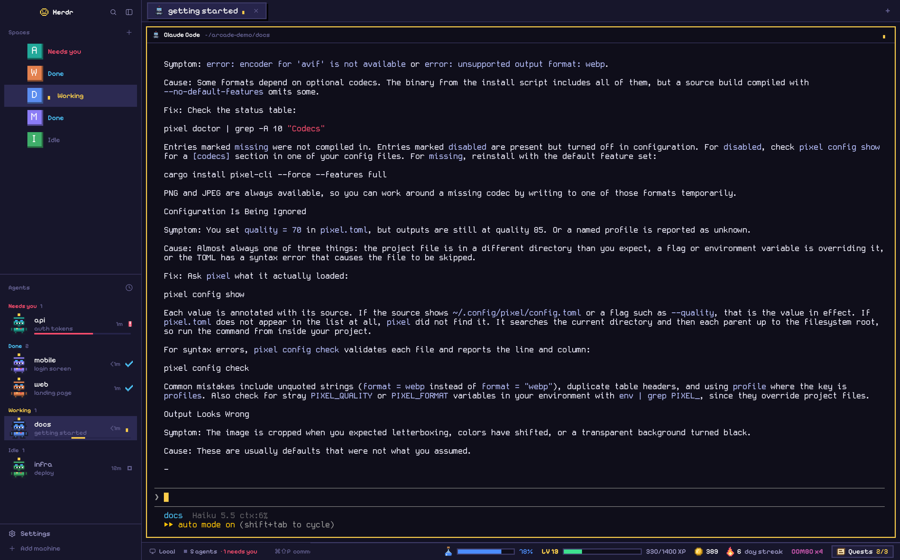
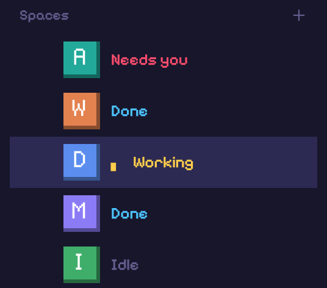
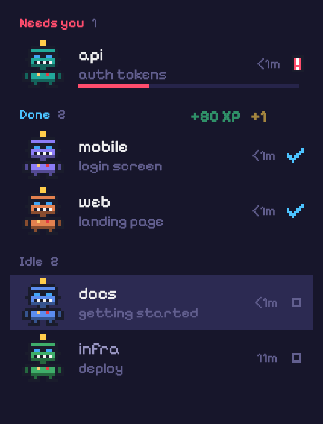
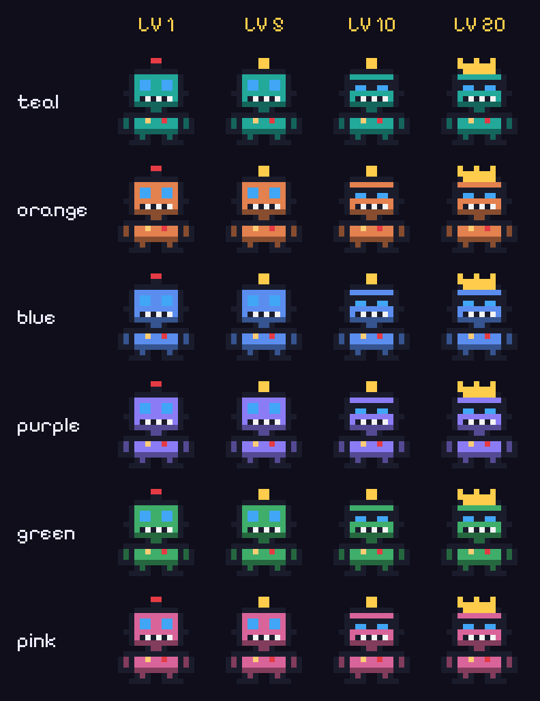
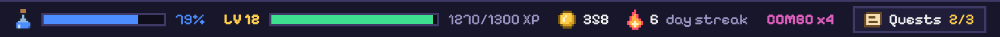
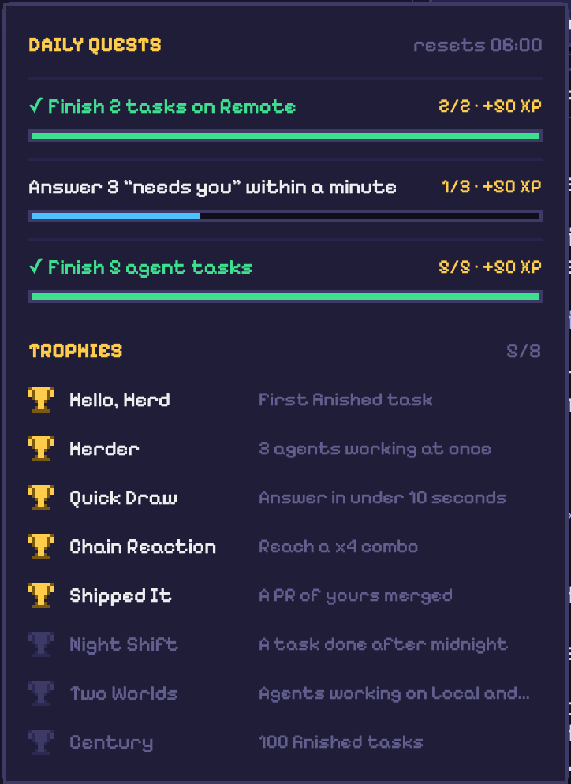
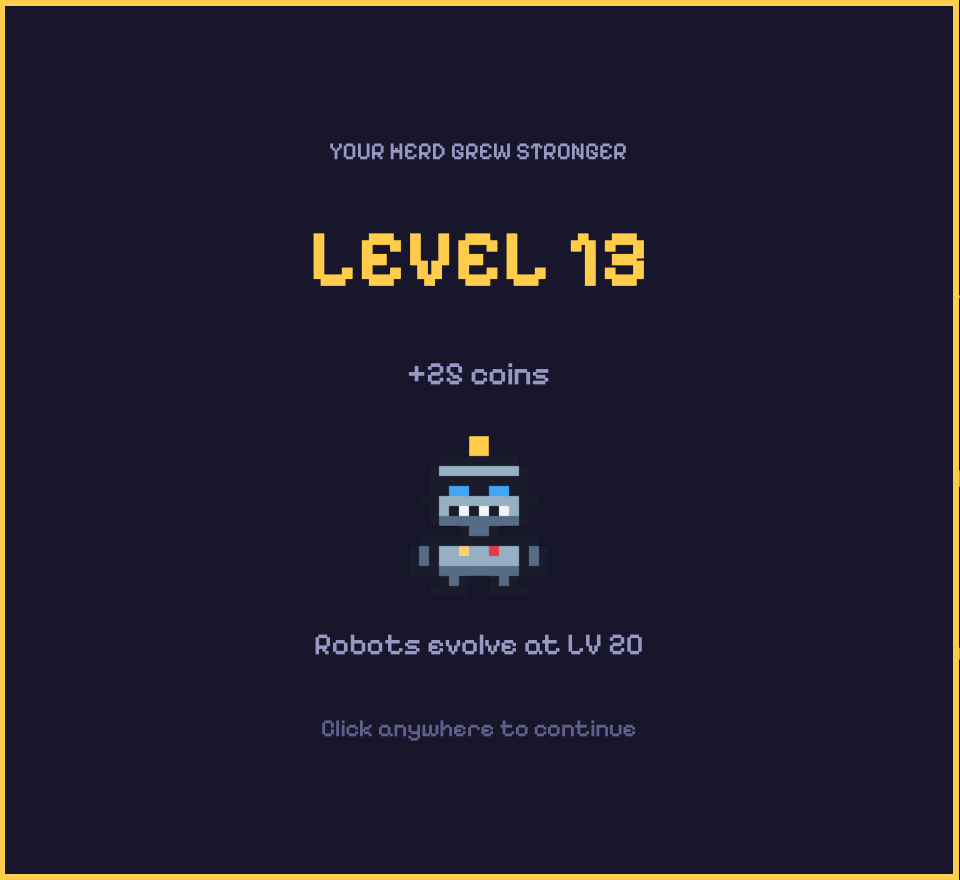
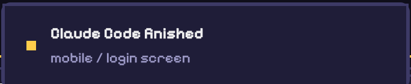

# Herdr Arcade

An 8-bit look and a small game layer for the [Herdr](https://herdr.dev) desktop app.



- **Retro look:** indigo and gold palette, dithered backgrounds, square bevelled panels, pixel font.
- **Pixel robots:** each Claude agent is a robot in the same color as its space's tile. Robots get antennas, a visor and then a crown as you level up.
- **Spaces as tiles:** each space is a bevelled letter tile under its machine (Local or Remote), with Working, Needs you, Done or Idle next to it.
- **Quest Mode:** a status bar HUD with XP, levels, coins, a daily streak, combos, three daily quests and achievements. Finishing agent tasks, unblocking agents quickly and merged PRs all score.
- **Mana bar:** how much of your weekly Claude limit is left, as a potion.
- **Chiptune sounds** for done, blocked, coins, combos, achievements and level-ups.
- **Quiet hours:** no sounds from 20:00 until 08:00.

Built and tested on Herdr 0.1.15 (macOS).

## Features

### Spaces

Each space is a letter tile with its status next to it: Needs you, Working, Done or Idle.



### Agents

Each agent is a pixel robot. An agent that needs you gets a red bar that fills while it waits, and a working agent gets a gold scanner. When an agent finishes, the XP and coins it earned float up from its row.



### Robots that evolve

Each robot wears its space tile's color: teal, orange, blue, purple, green or pink. Robots get a gold antenna at level 5, a visor at level 10 and a crown at level 20.



### Status bar HUD

From left: the mana potion (weekly Claude limit left), level and XP, coins, daily streak, current combo and today's quests.



### Quest log

Click Quests in the status bar to see today's three quests and your trophies.



### Level up



### Toasts

Herdr's notifications get the same pixel style.



The status bar needs a fairly wide window. In a narrow one, the HUD runs out of room and the mana potion is the first thing to disappear.

## Install

1. Copy the files into Herdr's folder. This adds new files and does not replace your own mods or layouts:

   ```sh
   git clone https://github.com/nedzadk/herdr-arcade.git
   cd herdr-arcade
   mkdir -p ~/.config/herdr-app
   cp -R mods layouts themes custom-icons ~/.config/herdr-app/
   ```

2. Install the fonts:
   - [Pixelify Sans](https://fonts.google.com/specimen/Pixelify+Sans) for the interface.
   - [GohuFont Nerd Font](https://www.nerdfonts.com/font-downloads) for the space tiles and terminals.

3. Turn it on:

   ```sh
   herdr-app do layout.switch '{"name":"arcade"}'
   herdr-app do app.theme '{"name":"arcade"}'
   ```

4. Optional: use the pixel robot as the Claude icon. Add this to `~/.config/herdr-app/programs.json`:

   ```json
   { "programs": { "claude": { "icon": "custom-icons/pixel-robot.svg", "tint": false } } }
   ```

5. Optional: use the chiptune alert sounds. In `~/.config/herdr-app/settings.json`:

   ```json
   "sounds": {
     "enabled": true,
     "done": "custom-icons/retro/done.mp3",
     "blocked": "custom-icons/retro/blocked.mp3"
   }
   ```

## Quest Mode

- `herdr-app do quest.quests` opens the quest log. Clicking the Quests button in the status bar does the same.
- `herdr-app do quest.preview-levelup` shows the level-up screen without changing your score.

How you score:

| Event | Reward |
| --- | --- |
| An agent finishes a task | 20 XP × combo (up to ×4 for finishes within 5 minutes) and 1 coin |
| You unblock an agent within 60 seconds | 10 XP |
| A daily quest is done | 50 XP and 5 coins |
| A PR of yours is merged | 100 XP and 10 coins |
| Level up | 25 coins |

Quests reset at 06:00. Your score is kept by Herdr between launches.

### Merged PRs

Quest Mode checks for merged PRs every 10 minutes with the [GitHub CLI](https://cli.github.com) (`gh`), using your default login. To check several accounts, list their gh config folders in `GH_CONFIGS` at the top of `mods/quest/main.js`.

## Mana bar

The potion shows how much of your weekly Claude limit is left. It needs a Claude Pro or Max plan.

1. Add the lines in [`extras/claude-usage-statusline.sh`](extras/claude-usage-statusline.sh) to your Claude Code [status line](https://code.claude.com/docs/en/statusline) script. They save your limits to `~/.claude/usage-limits.json` whenever the status line updates.
2. If you run Claude on a remote Herdr machine instead of this computer, set `USAGE_MACHINE` in `mods/quest/main.js` to that machine's name (from `hc machine ls`).

The bar refreshes once a minute.

## Customizing

- **Quiet hours:** `QUIET_FROM` and `QUIET_UNTIL` in `mods/quest/main.js`. At those times Quest Mode turns `sounds.enabled` in `settings.json` off and on, and mutes its own sounds.
- **Machine names:** every remote machine shows as "Remote". To name them, fill in `MACHINE_LABELS` in `mods/arcade-spaces/main.js`.

## License

Apache License 2.0, the same as Herdr. See [LICENSE](LICENSE) and [NOTICE](NOTICE).
